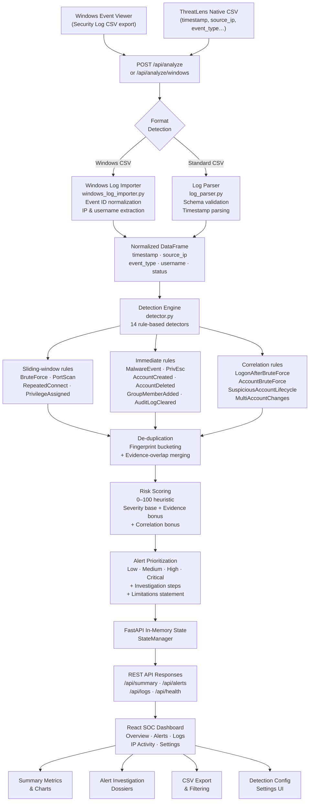

# ThreatLens — Security Operations Center Dashboard

> A portfolio-ready cybersecurity log-analysis and threat-detection application built with React + Vite (frontend) and Python FastAPI + Pandas (backend).

**ThreatLens is a demonstration project.** It analyzes uploaded log files locally, generates rule-based security alerts, and presents them in a professional SOC-style dashboard. It does **not** perform live network monitoring, packet capture, or any real-time surveillance. All sample data uses [RFC 5737](https://www.rfc-editor.org/rfc/rfc5737) documentation IP ranges and represents no real hosts or users.

---

## ⚠️ Important Disclaimer

All security events, IP addresses, usernames, and alerts shown in this project are **completely fabricated** and exist solely for demonstration purposes. ThreatLens does not monitor any live system, network, or infrastructure.

---

## Project Objectives

- Demonstrate a full-stack security analytics pipeline from raw CSV logs to prioritized SOC alerts.
- Implement transparent, rule-based threat detection with explainable scoring.
- Provide a professional SOC dashboard for alert investigation, filtering, and CSV export.
- Support ingestion of both ThreatLens-native CSVs and Windows Event Viewer exported Security logs.
- Serve as a portfolio piece showcasing Python, FastAPI, pandas, React, and data-visualization skills.

---

## Key Features

| Area | Feature |
|------|---------|
| **Dashboard** | Summary metrics, activity timeline, severity pie chart, top rules panel, suspicious IP rankings |
| **Alert Investigation** | Expandable per-alert dossiers with risk score, evidence table, detection rules, SOC steps, and limitations |
| **Multi-Dimension Filtering** | Filter by priority, severity, rule, affected account, source IP, status, and free-text search |
| **CSV Export** | RFC 4180–compliant export with formula-injection sanitization |
| **Windows Log Import** | Ingests Windows Event Viewer Security CSV exports; normalizes 10 critical Event IDs |
| **Explainable Risk Scoring** | Transparent 0–100 heuristic (base severity + evidence bonus + correlation bonus) |
| **Detection Configuration** | Live tuning of thresholds and windows via Settings UI; validated server-side |
| **Log Viewer** | Terminal-style log browser with level filtering and search |
| **IP Activity** | Host ranking by event count and threat level |
| **Application Modes** | Strict isolation between Clean LIVE MODE (real data only) and DEMO MODE (static demonstration data) |

---

## Technology Stack

| Layer | Technology | Version | Purpose |
|-------|-----------|---------|---------|
| Frontend | React | 19 | UI framework |
| Frontend | Vite | 8 | Build tool and `/api` dev proxy |
| Frontend | Recharts | 3 | Area and pie charts |
| Frontend | Lucide React | 1.60 | Icon library |
| Backend | Python | ≥ 3.10 | Detection engine runtime |
| Backend | FastAPI | ≥ 0.110 | ASGI REST API framework |
| Backend | Uvicorn | ≥ 0.28 | ASGI server |
| Backend | pandas | ≥ 2.0 | CSV parsing and time-window analysis |
| Backend | pytest | ≥ 7.4 | Automated test suite (399 tests) |

---

## Project Architecture



---

## Detection Capabilities

ThreatLens implements 14 detection rules across three categories:

### Sliding-Window Rules (time-bucketed)
| Rule | Event Type | Default Trigger |
|------|-----------|----------------|
| `BruteForce` | `LOGIN_FAILURE` | ≥ 5 failures from same IP within 60 s |
| `AccountBruteForce` | `LOGIN_FAILURE` | ≥ 5 failures against same username within 60 s |
| `PortScan` | `PORT_SCAN` | ≥ 3 events from same IP within 60 s |
| `RepeatedConnect` | `CONNECTION_ATTEMPT` | ≥ 10 events from same IP within 120 s |
| `PrivilegeAssigned` | `PRIVILEGE_ESCALATION` | ≥ 3 events from same IP within 300 s |

### Immediate Rules (single-event triggers)
| Rule | Event Type | Severity |
|------|-----------|---------|
| `MalwareEvent` | `MALWARE_DETECTED` | Critical |
| `PrivEsc` | `PRIVILEGE_ESCALATION` | Critical |
| `AuditLogCleared` | `AUDIT_LOG_CLEARED` | Critical |
| `AccountCreated` | `ACCOUNT_CREATED` | Medium |
| `AccountDeleted` | `ACCOUNT_DELETED` | Medium |
| `GroupMemberAdded` | `GROUP_MEMBER_ADDED` | Low |

### Correlation Rules (multi-event)
| Rule | Description |
|------|------------|
| `LogonAfterBruteForce` | Successful logon (`LOGIN_SUCCESS`) following ≥ 3 failures from same IP within 300 s |
| `SuspiciousAccountLifecycle` | Account created then immediately elevated or added to a group within 15 min |
| `MultiAccountChanges` | ≥ 3 mixed account-management events from same IP within 5 min |

### Risk Scoring Formula

```
risk_score = min(100, base_score + evidence_bonus + correlation_bonus)

base_score      = Critical → 70 | High → 50 | Medium → 30 | Low → 10
evidence_bonus  = 0 (1 event) … 20 (≥ 20 events)
correlation_bonus = +5 per additional rule (max +10)

priority_label  = Critical (≥ 80) | High (≥ 50) | Medium (≥ 25) | Low (0–24)
```

> **Note:** The risk score is a deterministic investigation-priority heuristic, not a probability of attack.

---

## Windows Security Log Import

ThreatLens accepts Windows Security Event Log exports in CSV format.

### How to export from Windows Event Viewer

1. Open **Event Viewer** (run `eventvwr.msc`).
2. Navigate to **Windows Logs → Security**.
3. In the right-hand Actions panel, click **"Save All Events As…"**.
4. Choose **CSV (Comma-Separated Values)** as the file format.
5. Upload the resulting `.csv` file via the **Log Analysis** page in **Live Mode**, or switch to **Demo Mode** in the top navigation to inspect sample Windows events.

### Supported Windows Event IDs

| Event ID | Mapped Event Type | Description |
|---------|------------------|-------------|
| 4624 | `LOGIN_SUCCESS` | Successful logon |
| 4625 | `LOGIN_FAILURE` | Failed logon |
| 4634 | `LOGOFF` | Logoff |
| 4648 | `EXPLICIT_CRED_LOGON` | Logon using explicit credentials |
| 4672 | `PRIVILEGE_ESCALATION` | Special privileges assigned |
| 4688 | `PROCESS_CREATED` | New process created |
| 4720 | `ACCOUNT_CREATED` | User account created |
| 4726 | `ACCOUNT_DELETED` | User account deleted |
| 4732 | `GROUP_MEMBER_ADDED` | Member added to local group |
| 1102 | `AUDIT_LOG_CLEARED` | Audit log cleared |

> **Note:** Native `.evtx` files are **not** supported. Only CSV exports from Event Viewer are accepted.

---

## Installation

### Prerequisites

- **Node.js** ≥ 18 and **npm** ≥ 9
- **Python** ≥ 3.10 and **pip**

### Clone

```bash
git clone https://github.com/your-username/ThreatLens.git
cd ThreatLens
```

---

## Backend Setup & Execution

```bash
# 1. (Optional) Create and activate a virtual environment
python -m venv venv
# Windows:
venv\Scripts\activate
# macOS/Linux:
source venv/bin/activate

# 2. Install Python dependencies
pip install -r backend/requirements.txt

# 3. Start the FastAPI backend on port 8000 with multi-tenant session isolation enabled
# Windows PowerShell:
$env:MULTI_TENANT_SESSIONS="true"
python -m uvicorn backend.api:app --reload --port 8000

# macOS / Linux:
MULTI_TENANT_SESSIONS=true python -m uvicorn backend.api:app --reload --port 8000
```

The backend will be available at **http://127.0.0.1:8000**.

Interactive API documentation (Swagger UI): **http://127.0.0.1:8000/docs**

---

## Frontend Setup & Execution

Open a **second** terminal:

```bash
# 1. Install frontend dependencies
npm install

# 2. Start the Vite development server
npm run dev
```

Open **http://localhost:5173** in your browser.

Vite proxies all `/api/*` requests to `http://127.0.0.1:8000` automatically, so no CORS configuration is needed during development.

---

## API Documentation

Once the backend is running, interactive API docs are available at:

- **Swagger UI**: http://127.0.0.1:8000/docs
- **ReDoc**: http://127.0.0.1:8000/redoc

### Key Endpoints

| Method | Path | Description | Access / Protection |
|--------|------|-------------|---------------------|
| `GET` | `/api/health` | Backend health, capabilities (`uploads_enabled`, `multi_tenant`, limits) | Public, no session needed |
| `POST` | `/api/session` | Issue a private visitor session token (`MULTI_TENANT_SESSIONS=true`) | Rate-limited (10/min per IP) |
| `DELETE` | `/api/session` | End your own session and free its data | `X-Session-ID` |
| `GET` | `/api/summary` | Dashboard metrics, charts, and suspicious IP rankings | `X-Session-ID` in session mode |
| `GET` | `/api/alerts` | Filterable alert list (severity, rule, IP, account, text search) | `X-Session-ID` in session mode |
| `GET` | `/api/logs` | Parsed log entries with level and text filters | `X-Session-ID` in session mode |
| `POST` | `/api/analyze` | Upload and analyze a standard ThreatLens CSV log | Rate-limited (20/min), blocked by read-only switch |
| `POST` | `/api/analyze/windows` | Upload and analyze a Windows Event Viewer CSV export | Rate-limited (20/min), blocked by read-only switch |
| `POST` | `/api/reset` | Reset dataset (clean empty by default; `?sample=true` for demo) | Blocked by read-only switch |
| `POST` | `/api/sample` | Explicitly load standard synthetic sample dataset | Blocked by read-only switch |
| `GET` | `/api/detection/config` | Retrieve current detection thresholds | `X-Session-ID` in session mode |
| `PUT` | `/api/detection/config` | Update detection thresholds (validated). Per-session in session mode | Blocked by read-only switch; `ADMIN_API_KEY` (single-tenant mode, if set) |
| `GET` | `/api/windows/supported-events` | List supported Windows Event IDs | Public |

In session mode (`MULTI_TENANT_SESSIONS=true`) a missing, malformed, unknown or expired `X-Session-ID` always returns `401`; there is never a fallback to another dataset.

---

## Running Automated Tests

```bash
# Run all 399 backend tests with verbose output
python -m pytest backend/tests/ -v --tb=short
```

Expected result: **399 passed, 1 warning** (warning is an upstream Starlette TestClient HTTPX deprecation notice).

### Test coverage

| Test file | Tests | Coverage |
|-----------|-------|---------|
| `test_engine.py` | 39 | Log parser, all detection rules, deduplication |
| `test_api.py` | 17 | Health, summary, alerts, logs, analyze, reset endpoints |
| `test_phase4.py` | 22 | Filters, CSV upload, size validation, field completeness |
| `test_phase6.py` | 83 | Risk scoring, priority labels, config API, regression |
| `test_windows_importer.py` | 25 | Windows CSV parsing, Event ID normalization, API endpoints |
| `test_mode_isolation.py` | 11 | Clean Live Mode startup, empty state isolation, reset behavior |
| `test_correlated_evidence.py` | 8 | Correlated supporting evidence, login sequences, investigation context |
| `test_production_config.py` | 23 | Security headers, CORS origin filtering, rate limiting, upload guards, portfolio read-only mode, admin API key |
| `test_session_unit.py` | 31 | Session manager: tokens, expiry, leases, transactions, memory reservations, analysis slots |
| `test_session_api.py` | 138 | Visitor isolation, uploads/resets/sample/config per session, invalid and expired sessions, limits, concurrency, read-only kill switch, client-IP rate limiting, CORS |

---

## Production Build

```bash
# Build the frontend for production
npm run build
```

Output is placed in `dist/`. Serve with any static file server, or configure Nginx/Caddy/Vercel to host the client bundle.

---

## Example Workflow

1. **Start both services** (backend on 8000, frontend on 5173).
2. **Open the dashboard** at http://localhost:5173 — ThreatLens starts cleanly in **LIVE MODE** with zero fabricated data (0 events, 0 alerts).
3. **Switch to DEMO MODE** via the top navigation toggle at any time to safely explore the interactive demonstration dataset and charts.
4. **Switch back to LIVE MODE** and navigate to **Log Analysis** to upload a CSV log (either ThreatLens-native CSV or Windows Event Viewer CSV export).
5. **Review the Overview page** for real analyzed metrics, activity timeline, and severity distribution.
6. **Navigate to Alerts** — click any row to inspect the Investigation Dossier (risk score, triggered evidence, contextual timeline, and SOC next steps).
7. **Filter alerts** by priority, rule, affected account, or source IP, and export results to CSV.
8. **Tune thresholds** in Settings → Detection Thresholds, then re-analyze logs to observe updated behavior.
9. **Reset** live data at any time via the "Reset Live Data (Clear)" button.

---

## Project Structure

```
ThreatLens/
├── backend/
│   ├── data/
│   │   ├── sample_logs.csv                 # Synthetic ThreatLens-native demo log
│   │   └── sample_windows_security_log.csv # Sample Windows Event Viewer CSV export
│   ├── tests/
│   │   ├── __init__.py
│   │   ├── test_api.py                     # FastAPI endpoint integration tests
│   │   ├── test_correlated_evidence.py     # Correlated evidence & investigation context tests
│   │   ├── test_engine.py                  # Log parser & detection rule unit tests
│   │   ├── test_mode_isolation.py          # Clean Live Mode startup & state isolation tests
│   │   ├── test_phase4.py                  # Filter, upload, and resilience tests
│   │   ├── test_phase6.py                  # Risk scoring, config API, regression tests
│   │   ├── test_production_config.py       # Security headers, rate limiting, and auth tests
│   │   └── test_windows_importer.py        # Windows log parser & detection tests
│   ├── __init__.py
│   ├── api.py                              # FastAPI app, endpoints, StateManager
│   ├── detector.py                         # 14 detection rules, risk scoring, deduplication
│   ├── log_parser.py                       # ThreatLens native CSV parser
│   ├── windows_log_importer.py             # Windows Event Viewer CSV importer
│   ├── main.py                             # CLI entry point
│   ├── requirements.txt                    # Python dependencies
│   └── README.md                           # Backend module documentation
├── public/
│   ├── favicon.svg
│   └── icons.svg
├── src/
│   ├── assets/
│   ├── components/
│   │   ├── Badges.jsx          # SeverityBadge, StatusBadge, PriorityBadge, RiskScoreBadge
│   │   ├── Header.jsx          # Top header with mode switcher
│   │   └── Sidebar.jsx         # Left navigation
│   ├── context/
│   │   └── ThreatLensContext.jsx  # Global state (backend data, uploads, demo fallback)
│   ├── data/
│   │   └── demoData.js         # Static fallback demo data
│   ├── pages/
│   │   ├── OverviewPage.jsx    # Summary dashboard with charts and recent alerts
│   │   ├── AlertsPage.jsx      # Alert management with investigation dossiers
│   │   ├── LogsPage.jsx        # Log viewer and CSV upload UI
│   │   ├── IPActivityPage.jsx  # Host ranking by activity and threat level
│   │   └── SettingsPage.jsx    # Detection config and engine status
│   ├── services/
│   │   └── api.js              # Frontend HTTP client for the FastAPI backend
│   ├── App.jsx                 # Root component (navigation + ThreatLensProvider)
│   ├── main.jsx                # Vite entry point
│   └── index.css               # Global dark navy SOC design system (CSS variables)
├── index.html
├── package.json
├── vite.config.js              # Vite + /api proxy configuration
├── .gitignore
├── .env.example                # Environment variable template (no secrets)
└── README.md                   # This file
```

---

## Security & Architectural Design

ThreatLens is built as an educational and portfolio demonstration application. Its architecture reflects specific security, privacy, and simplicity trade-offs:

- **Per-visitor sessions for public uploads (`MULTI_TENANT_SESSIONS=true`):** The backend issues each visitor a random 256-bit token (`POST /api/session`). The frontend keeps it in `sessionStorage` and sends it as `X-Session-ID`. Summaries, alerts, logs, uploads, Windows uploads, resets, sample loading and detection thresholds all act only on that session's private in-memory state. There is no shared dataset in this mode, and a missing, malformed, unknown or expired token returns `401`; it never falls back to another visitor's (or a global) dataset. Sessions expire after 30 idle minutes (5 minutes if nothing was uploaded). Session count, per-session and total memory, concurrent analyses, file size and row count are all capped.
- **Emergency read-only switch (`PORTFOLIO_READ_ONLY=true`):** Independent of session mode. When true, every write (`/api/analyze`, `/api/analyze/windows`, `/api/reset`, `/api/sample`, `/api/detection/config`) returns `HTTP 403` unless a valid `ADMIN_API_KEY` is presented; reads keep working. Flip it to instantly shut off uploads on a live deployment. Guard rail: on Render, `PORTFOLIO_READ_ONLY=false` *without* `MULTI_TENANT_SESSIONS=true` would let visitors overwrite one shared dataset, so the backend forces read-only in that case (override only with `ALLOW_SHARED_GLOBAL_STATE=true`).
- **Unrestricted Public Demo Mode:** Reviewers, recruiters, and visitors can freely explore all SOC dashboard metrics, interactive timeline charts, severity distributions, and investigation dossiers in **Demo Mode**, which is evaluated entirely within the client browser without authentication or server state mutations.
- **Local mode (`MULTI_TENANT_SESSIONS=false`, `PORTFOLIO_READ_ONLY=false`):** When running locally, one process-wide dataset is used and all Live Mode features are open, exactly as before.
- **Administrative Key Authorization (`ADMIN_API_KEY`):** If configured in the backend environment, an operator can authorize writes while the read-only switch is on via `X-Admin-Key` or `Authorization: Bearer <key>` using constant-time `hmac.compare_digest`. In session mode the admin key only ever writes into the caller's own session. No secret keys are bundled into the client JavaScript or exposed through frontend environment variables; visitors never need one.
- **In-Memory Volatile Processing:** All CSV log parsing, detection evaluation, and alert correlation occur entirely in RAM via Pandas and FastAPI. No relational database, file cache, or persistent disk storage is used. When the container stops or restarts, active data vanishes completely.
- **In-Memory Privacy Guarantee:** Uploaded logs are never saved to disk, forwarded to external analytics, or written to persistent volumes.
- **Resource Protection & DoS Guardrails:** To protect public demo containers from memory exhaustion:
  - File size cap (`MAX_UPLOAD_SIZE_MB`, default 10 MB): checked from `Content-Length` before the body is spooled, and again while streaming.
  - Row cap (`MAX_UPLOAD_ROWS`, default 50,000): enforced after parsing but before the expensive detection step.
  - Memory budgets: per session (`MAX_SESSION_MEMORY_MB`) and global (`MAX_TOTAL_MEMORY_MB`), enforced with reservations before parsing and re-checked on the analysed result. These are budgets for dataset memory, not process RSS.
  - Concurrency: at most `MAX_CONCURRENT_ANALYSES` uploads are processed at once; extra uploads fail fast with `503` + `Retry-After`. Parsing and detection run in worker threads, so the API stays responsive.
  - Session count (`MAX_ACTIVE_SESSIONS`) and per-IP session-creation rate limit.
  - Rate limiting: sliding window per client IP (120 req/min general, 20/min uploads, 10/min new sessions). `X-Forwarded-For` is never trusted; set `CLIENT_IP_HEADER` (defaults to `true-client-ip` on Render).
  - The summary is computed once per upload and cached, not on every request.
- **No Live Network Sniffing:** ThreatLens is an offline/batch security log analyzer. It does not perform live network sniffing, packet capture (PCAP), or real-time event streaming.
- **No Native `.evtx` Parsing:** Windows Event Viewer logs must be exported to CSV before upload; proprietary binary `.evtx` files are not accepted.

---

## Current Limitations

- **One dataset per visitor session:** Uploading a new log replaces that session's dataset. Sessions are per browser tab (`sessionStorage`); a new tab starts a new, empty session.
- **Sessions live in one process:** Run a single uvicorn worker. A restart, redeploy or free-tier idle spin-down clears every session (visitors are told their session expired and start empty).
- **Memory limits are budgets, not guarantees:** They count dataset memory only; Python and pandas overhead and transient parsing buffers are extra, so keep headroom on small instances.
- **Rule-based heuristics:** Detections are deterministic threshold heuristics without machine-learning anomaly scoring.
- **Simulated demonstration data:** All bundled sample logs use RFC 5737 documentation IP ranges and fictitious usernames.

---

## Future Improvements

- Add multi-tenancy and JWT-based authentication for a shared deployment.
- Support multiple concurrent datasets and historical comparison.
- Implement file-based or database-backed persistent storage.
- Add native `.evtx` parsing via the `python-evtx` or `evtx` library.
- Extend the detection rule set with additional Windows Event IDs (e.g., 4740 Account Lockout, 4776 Credential Validation).
- Add a machine-learning anomaly detection layer alongside the rule engine.
- Provide a REST WebSocket endpoint for real-time alert streaming.
- Add user-controllable alert status management (Open → Investigating → Resolved).
- Package as a Docker Compose application for easier deployment.
- Add a CI/CD pipeline with GitHub Actions.

---

## Running ThreatLens — Quick Reference

```bash
# Terminal 1 — Backend
pip install -r backend/requirements.txt
python -m uvicorn backend.api:app --reload --port 8000

# Terminal 2 — Frontend
npm install
npm run dev

# Run all tests
python -m pytest backend/tests/ -v --tb=short

# Production frontend build
npm run build
```

| URL | Description |
|-----|-------------|
| http://localhost:5173 | React SOC Dashboard |
| http://127.0.0.1:8000/docs | FastAPI Swagger UI |
| http://127.0.0.1:8000/api/health | Health check endpoint |
